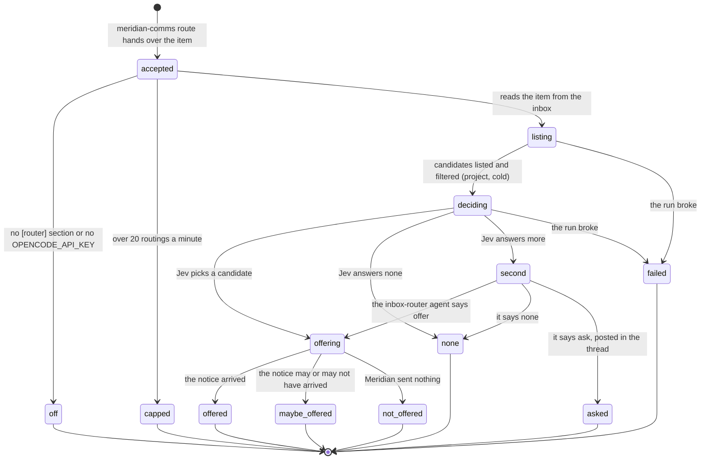

# State machine: a routing in meridian-comms

One routing of one inbox item by the meridian-comms router. It is recorded as one line of
`~/.local/state/meridian-comms/routes.jsonl` on the bot host (`Outcome` in `src/routes.rs`, the
steps in `src/core/route.rs`). This page lives in the meridian-cli atlas because meridian-comms
has no state machine pages of its own yet. It belongs beside `src/routes.rs` in that repository.

- **Final or not.** `off`, `capped` and `failed` leave the item waiting, and a later `route`
  for it runs again. Every other outcome is final (`Outcome::is_final`), and on restart the
  daemon rebuilds the set of routed items from the log (`Routing::resume`).
- **A reply to an `ask`** starts a second routing of the same item, logged with `again: true`.
- **Nothing here holds the text.** The text goes to Jev and to the agent, and to no post,
  command line or log line.
- Every outcome leaves the Meridian message waiting in the inbox until a session takes it. An
  offer grants nothing ([an inbox message](../../src/meridian/lib/inbox/.context/state-machines.md)).
