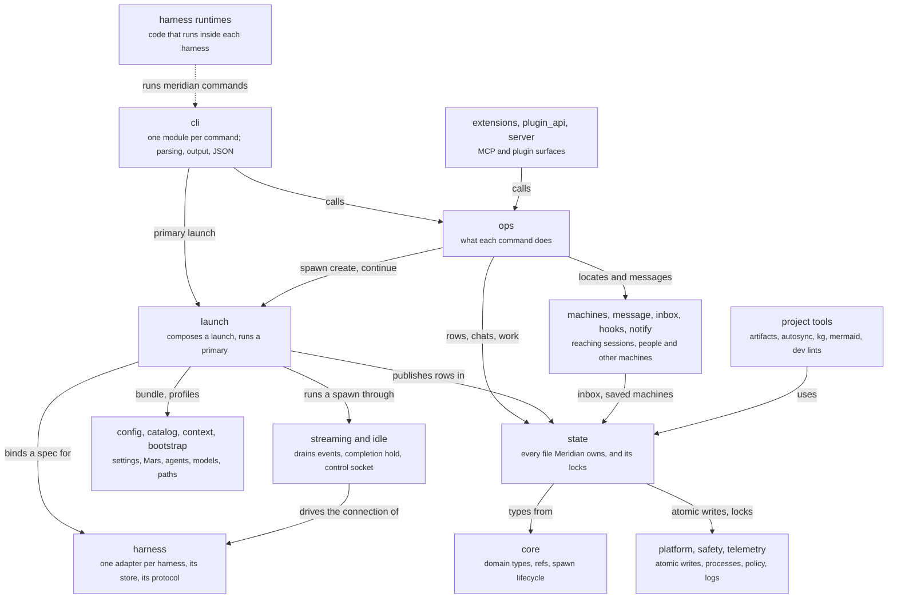

# Code

- View: code

Meridian's Python packages, as layers: commands on top, files at the bottom. An arrow means
"uses". The import graph isn't a strict tree: launch, harness and streaming call into each other
around a running spawn. The arrows show the direction each layer is meant to depend in. The
rules that are enforced are listed under each box, and `src/meridian/dev/lints.py` checks them.
Paths are under `src/meridian/`.

## cli

`cli/`: the command surface, one module per command group, on Cyclopts. `main.py` sets up the
invocation: the project, `-C`, and the caller's identity, which `-C` into another project drops
from the environment. Output is text or `--json`, which scripts and other programs parse.

- Kind: package
- Paths: `src/meridian/cli`

## ops

`lib/ops/`: what each command does once it has its arguments: spawns (`ops/spawn/`), sessions,
work items, Mars, config, locating a reference (`locate.py`).

- Kind: package
- Paths: `src/meridian/lib/ops`

Under `ops/spawn/`, the depth guard and the sandbox check run before any row exists, and
foreground and background spawns meet at one function (`AGENTS.md` there).

## launch

`lib/launch/`: turns a request into a launch. Prepare it once, then bind it for each preview or
run. A harness adapter takes the bound argv, environment and permissions and composes nothing
itself. `launch/process/` runs a primary in the foreground, under a terminal it owns.

- Kind: package
- Paths: `src/meridian/lib/launch`

## harness

`lib/harness/`: everything harness-specific. Each harness has one adapter, its native store
reader, its projections (how Meridian's policy becomes the harness's flags and config) and
its connection (`connections/`). Everything outside reaches a harness through the contract in
`adapter.py` and the registry. A new harness is one adapter plus registration. Pi's own
completion engine (`pi_drain.py` and its `pi_*` parts) lives here too; streaming reaches it
through the connection's `drain_plan`.

- Kind: package
- Paths: `src/meridian/lib/harness`

Enforced: harness code doesn't import `lib/idle` (the launcher owns idle policy), and doesn't
start bootstrap at import time; code outside `lib/harness/` doesn't import a harness's own
module, `adapter_base` or `legacy_native_stores` (two legacy-import exceptions are listed).

## streaming

`lib/streaming/` drains a running harness's events, decides when a child is done (the
completion hold) and serves the control socket. `lib/idle/` decides the idle push and warning,
for every harness.

- Kind: package
- Paths: `src/meridian/lib/streaming`, `src/meridian/lib/idle`
- Machines: [the completion hold](../../src/meridian/lib/streaming/.context/state-machines.md), [an idle stretch](../../src/meridian/lib/idle/.context/state-machines.md)

## reach

How a session reaches anything outside itself. `lib/machines/` makes the SSH call to a saved
machine, `lib/message/` handles addresses and the people route, `lib/inbox/` is the machine
inbox, `lib/hooks/` runs user hook rows, and `lib/notify/` sends notifications.

- Kind: package
- Paths: `src/meridian/lib/machines`, `src/meridian/lib/message`, `src/meridian/lib/inbox`, `src/meridian/lib/hooks`, `src/meridian/lib/notify`
- See: [Saved machines](saved-machines.md), [Inbox and router](inbox.md)
- Machines: [an inbox message](../../src/meridian/lib/inbox/.context/state-machines.md)

## config

Settings and catalogs. `lib/config/` reads layered config (user, project, local) and edits
it with its comments kept. `lib/catalog/` holds agents, models and the Mars roots.
`lib/context/` resolves the KB and work directories. `lib/bootstrap/` prepares a runtime for a
read or a write.

- Kind: package
- Paths: `src/meridian/lib/config`, `src/meridian/lib/catalog`, `src/meridian/lib/context`, `src/meridian/lib/bootstrap`
- See: [Mars](mars.md)

## state

`lib/state/`: every file Meridian owns. Spawn rows, the chat journal, work items, machine IDs,
saved machines, idle state, the history index and the reaper. It is the authority. SQLite
indexes are projections that can be rebuilt.

- Kind: package
- Paths: `src/meridian/lib/state`
- See: [Data](data.md)
- Machines: [a spawn's status](../../src/meridian/lib/state/spawn/.context/state-machines.md), [chats, primaries and work items](../../src/meridian/lib/state/.context/state-machines.md)

Enforced: an authoritative write goes through `lib/state`'s wrappers or the atomic-write helpers.
The lints flag a raw write.

## core

`lib/core/`: what every layer shares. Domain types and the spawn status vocabulary, reference
parsing (`refs.py`), the spawn application service (`spawn_service.py`, which writes every
terminal status) and lifecycle events. `lib/utils/` has the shared JSON shapes.

- Kind: package
- Paths: `src/meridian/lib/core`, `src/meridian/lib/utils`

## platform

Below everything. `lib/platform/` holds atomic writes, file locks, process launch and process
scopes. `lib/safety/` holds budget, guardrail and permission policy. `lib/telemetry/` and
`lib/observability/` hold local JSONL telemetry and debug traces.

- Kind: package
- Paths: `src/meridian/lib/platform`, `src/meridian/lib/safety`, `src/meridian/lib/telemetry`, `src/meridian/lib/observability`

## surfaces

The ways other programs call Meridian besides the CLI. `server/` is an MCP server on stdio,
`lib/extensions/` is the extension registry and its command surface, and `plugin_api/` is the
stable surface for outside plugins, kept free of state internals.

- Kind: package
- Paths: `src/meridian/server`, `src/meridian/lib/extensions`, `src/meridian/plugin_api`

## runtime

Code that runs inside a harness, not inside Meridian: Claude Code plugins (`claude_runtime/`), Pi
extensions in TypeScript (`pi_runtime/`), the tool-rule evaluator shared by Pi and Codex
(`tool_policy_runtime/`), and Meridian's own Mars package (`mars/`: skills, agents, the agy hook
and MCP server). It reaches Meridian by running `meridian` commands.

- Kind: package
- Paths: `src/meridian/claude_runtime`, `src/meridian/pi_runtime`, `src/meridian/tool_policy_runtime`, `src/meridian/mars`

## tools

Features beside the main path. `lib/artifact/` publishes artifacts through Tailscale serve.
`lib/autosync/` is Python's half of context autosync, whose daemon is the Rust crate
`crates/meridian-sync`. `lib/kg/`, `lib/markdown/` and `lib/mermaid/` check a docs tree's links
and diagrams. `dev/` holds the source-tree lints and the version files.

- Kind: package
- Paths: `src/meridian/lib/artifact`, `src/meridian/lib/autosync`, `crates/meridian-sync`, `src/meridian/lib/kg`, `src/meridian/lib/markdown`, `src/meridian/lib/mermaid`, `src/meridian/dev`
