# meridian-comms

- View: where it runs

meridian-comms is a Slack bot for handing work to someone's agent sessions and getting the
answer in the same thread. Its daemon runs as a user service on one machine, the bot host
(`raspberry` today). It wakes the sessions a person names. A message that names nobody wakes
nobody: it is filed in Meridian's machine inbox, and the router may offer it to one running
session ([Inbox and router](inbox.md)). The numbered path is a person's message reaching a
session. Code is in the `meridian-comms` repository (`main`, commit `47bcfd3`), which says what
it does and why in `docs/design.md`.

```mermaid
flowchart LR
  person["person<br/><small>mentions the bot, or writes in its thread</small>"]:::person
  slack["Slack<br/><small>Socket Mode events, Web API posts</small>"]:::external
  subgraph bothost["Bot host: the meridian-comms daemon"]
    surface["Slack surface<br/><small>events in, posts and the picker out</small>"]:::module
    core["core<br/><small>thread state and the wake rule</small>"]:::module
    threads["thread files<br/><small>one JSON file per thread, cursor, routes.jsonl</small>"]:::store
    source["Meridian source<br/><small>the one module that runs meridian</small>"]:::module
    router["router<br/><small>offers an unnamed message to one session</small>"]:::module
    sock["client socket<br/><small>owner-only Unix socket</small>"]:::files
  end
  meridian["meridian<br/><small>spawn list, message, inbox</small>"]:::service
  session["a Meridian primary<br/><small>woken with a one-line notice</small>"]:::client
  person -->|"1. writes"| slack
  slack -->|"2. event"| surface
  surface -->|"3. a message that counts"| core
  core -->|"4. records scope, pending, woken"| threads
  core -->|"5. list and wake the chosen refs"| source
  source -->|"6. meridian message <ref> --wake"| meridian
  meridian -->|"7. notice through the control socket"| session
  session -->|"8. meridian-comms read, send"| sock
  sock -->|"reaches"| core
  core -->|"posts the answer, the picker"| surface
  source -->|"nobody woken: files it"| router
  router -->|"spawn list --global, inbox offer"| meridian
```

## person

Someone in the directory (`[people]` in the config) writing in a configured channel. A message
counts when it opens with a real mention of the bot, or sits in a thread the bot already has a
file for.

- Kind: person

## slack

Slack delivers events and clicks over the bot's Socket Mode websocket, and the daemon posts
through the Web API. One daemon runs per bot, because Slack splits Socket Mode events across
open connections.

- Kind: external
- Keys: the Slack app token and bot token, in `~/.config/meridian-comms/slack.env` on the bot host.

Code: `src/surface/slack/socket.rs`, `src/surface/slack/web.rs`.

## surface

Where people talk. It turns Slack events into messages the core understands, drops the bot's
own posts, edits and deletions, and draws posts, including the picker's menu of running
sessions.

- Kind: module

Code: `src/surface/`.

## core

The wake rule, and everything that knows a thread. To deliver a message to a person it asks
every source for that person's candidates and wakes the ones in the thread's scope, or the
source's defaults when the scope is empty, skipping any that are cold. A person's choice
(`to: <ref>`, the picker's Wake button, `meridian-comms send --to`) replaces the scope and wakes
cold sessions too: a guess must not wake a cold session, a person's choice may. All three ways
in go through one function, `deliver` in `src/core/deliver.rs`. When nobody is woken the
message is pending, and the bot says in the thread who was skipped and why.

- Kind: module
- Machines: [a routing](../../.context/state-machines/meridian-comms.md)

Code: `src/core/` (`events.rs`, `deliver.rs`, `api.rs`, `route.rs`, `filing.rs`).

## threads

The daemon's own state under `~/.local/state/meridian-comms/`: one JSON file per Slack thread
(`threads/`), `cursor.json`, and `routes.jsonl`, the routing log. The daemon is the only writer,
and the routing log never holds message text.

- Kind: store

Code: `src/state.rs`, `src/routes.rs`, `src/paths.rs`.

## source

Where agents run. The Meridian source is the only module that runs `meridian`, so meridian-comms
still reads and posts Slack threads on a machine without Meridian. It lists candidates (the
running primaries of the channel's project), wakes them, files messages in the inbox and offers
them. It parses only Meridian's public CLI and JSON. At start it checks for `meridian inbox`.
Without it (Meridian before 0.28), nothing is filed and an unnamed message waits in the
daemon's own pending list.

- Kind: module

Code: `src/source/meridian/mod.rs`.

## router

Gives a message that woke nobody to the one running session it most likely belongs to. It runs
when Meridian's `inbox.received` hook runs `meridian-comms route`. It lists running primaries
here and on every saved machine, asks Jev (a decision model served through OpenCode), and when
Jev isn't sure it starts Meridian's built-in `inbox-router` agent. It only offers, so a cold
session is never chosen.

- Kind: module
- Opens: [Inbox and router](inbox.md)
- Machines: [a routing](../../.context/state-machines/meridian-comms.md)
- Keys: `OPENCODE_API_KEY` for Jev, in the same `slack.env`.

Code: `src/core/route.rs`, `src/jev.rs`, `src/source/meridian/router.rs`.

## sock

The daemon's socket for session clients: `/run/user/<uid>/meridian-comms.sock` when that
directory exists, otherwise under the state directory. It's owner-only and not a network
listener. A session's `meridian-comms read`, `send` and `list` identify the caller from its
`MERIDIAN_*` variables. A spawned child may read but not post.

- Kind: files
- Opens: [Agent to person](person-message.md)

Code: `src/client.rs`, `src/proto.rs`.

## meridian

Meridian on the bot host, run as a command. The source uses `spawn list --primary --json`
(with `--global` for saved machines), `machine list`, `message <ref> --wake`, `message inbox -`,
and `inbox read`, `offer` and `take` (it takes a filed message when a person then chooses a
session for it), all with `--json`. It
learns of a new inbox message from the `inbox.received` hook row the user adds to
`~/.meridian/config.toml`. A change to any of that output changes a program outside the
meridian-cli repository.

- Kind: service
- Paths: `src/meridian/cli/message.py`, `src/meridian/cli/inbox_cmd.py`, `src/meridian/lib/inbox`
- Machines: [an inbox message](../../src/meridian/lib/inbox/.context/state-machines.md)

## session

The woken primary. Its notice names the message and carries no text, and the session fetches
the text with `meridian-comms read`. A session on another machine is reached by an offer, never
by a wake, because the projects in the bot's config are directories on the bot host.

- Kind: client
