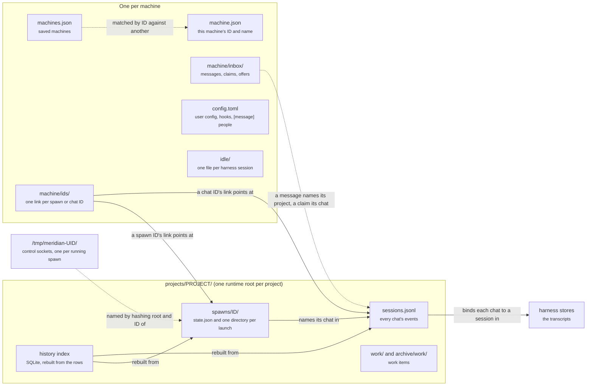

# Data

- View: data

What Meridian records, and where. Everything is a file under `~/.meridian/` (`$MERIDIAN_HOME`),
except the control sockets under `/tmp` and what the harnesses keep in their own stores. Files
are the authority. A SQLite index is a projection that can always be rebuilt. Every write is
atomic, and every reader survives a half-written file. An arrow says which record points at, or
is rebuilt from, which.

## identity

`~/.meridian/machine.json`: the machine's fixed random ID, its name and its earlier names.
Written once. Only `meridian machine rename` changes the name.

- Kind: files
- Paths: `src/meridian/lib/state/machine_identity.py`

## saved

`~/.meridian/machines.json`: one entry per machine this one can reach (`name`, `ssh`, `id`,
`was`). A file Meridian owns, with a format version. The path of `meridian` on each machine is
cached beside it, in `cache/machines/<machine id>.json`. Nothing depends on the cache being
right.

- Kind: files
- Paths: `src/meridian/lib/state/saved_machines.py`, `src/meridian/lib/machines/discover.py`

## claims

`~/.meridian/machine/ids/p/<n/1000>/p<n>` and `.../c/...`: a symbolic link per issued ID, pointing
at its runtime root. Never rewritten or deleted.

- Kind: store
- Paths: `src/meridian/lib/state/machine_ids.py`
- See: [Issuing an ID](ids.md)

## inbox

`~/.meridian/machine/inbox/`: messages addressed to no session. One immutable file per message,
plus claim, offer, origin and hook-log files. `store.py` is its only writer.

- Kind: store
- Paths: `src/meridian/lib/inbox/store.py`
- Machines: [an inbox message](../../src/meridian/lib/inbox/.context/state-machines.md)

## userconfig

`~/.meridian/config.toml`, the user layer of config. A project adds `meridian.toml` and
`meridian.local.toml` above it. `[message]` and `[inbox]` are read from the user file only,
and so are the hook rows for machine events such as `inbox.received`. Meridian runs them
outside the harness sandbox, so a repository's file must not be able to name a program.

- Kind: files
- Paths: `src/meridian/lib/config`
- Docs: [configuration](../configuration.md)

## idle

`~/.meridian/idle/<harness>-<session>.json`: one harness session's idle stretch. Files older than
seven days are collected.

- Kind: files
- Paths: `src/meridian/lib/state/idle_store.py`
- Machines: [an idle stretch](../../src/meridian/lib/idle/.context/state-machines.md)

## spawns

`spawns/<id>/state.json` is the authoritative record of a spawn. Each launch has its own
directory with the prompts, `params.json`, `output.jsonl`, `stderr.log`, `report.md` and the
permission journal. `launch.lock` beside it is held by the runner for its whole life. A
continued spawn keeps earlier launches as archives.

- Kind: store
- Paths: `src/meridian/lib/state/spawn_store.py`, `src/meridian/lib/state/spawn`, `src/meridian/lib/state/paths.py`
- Machines: [a spawn's status](../../src/meridian/lib/state/spawn/.context/state-machines.md)

## journal

`sessions.jsonl`: one append-only file per runtime root with every chat's start, stop, update
and binding events. A chat has no file of its own, which is why a chat ID needs its claim to be
found from outside its project.

- Kind: store
- Paths: `src/meridian/lib/state/session_store.py`, `src/meridian/lib/state/session_fold.py`
- Machines: [a chat's generation](../../src/meridian/lib/state/.context/state-machines.md)

## work

Work items: a directory per item with its `__status.json` and its files. By default the
directory is under the runtime root. A project can point it at a git clone that the
`meridian-sync` daemon keeps in sync, under `~/.meridian/git/`. Where the directory sits, active
or archived, is the item's state.

- Kind: store
- Paths: `src/meridian/lib/state/work_repository.py`, `src/meridian/lib/state/work_store.py`
- Machines: [a work item](../../src/meridian/lib/state/.context/state-machines.md)

## index

`history-index/`: the SQLite index used for listings and search. It finds new spawns by listing
the root's `spawns/` directory. Deleting it loses nothing.

- Kind: store
- Paths: `src/meridian/lib/state/history_index.py`, `src/meridian/lib/state/native_search_index.py`

## sockets

`/tmp/meridian-<uid>/control-<hash>.sock`, mode 0700, always under `/tmp` whatever `TMPDIR`
says, so a sender in any environment computes the same name. The hash is SHA-256 of the
runtime root and spawn ID. A socket exists only while its spawn runs, and stale ones are swept.

- Kind: files
- Paths: `src/meridian/lib/streaming/control_socket.py`

## native

The harnesses' own stores: Claude Code under `~/.claude` (or `CLAUDE_CONFIG_DIR`), Codex under
`~/.codex` (or `CODEX_HOME`), Pi under `~/.pi/agent` (spawned Pi sessions under
`~/.meridian/meridian-pi/`), agy under `~/.gemini/antigravity-cli/`. Meridian reads them and
binds each chat to one session there, so every session can be resumed without Meridian.

- Kind: store
- Paths: `src/meridian/lib/harness`
