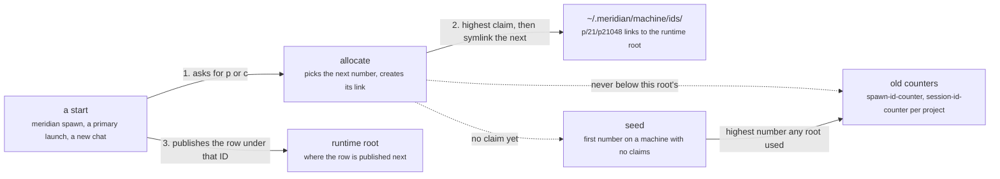

# Issuing an ID

- View: a request's path

How a new spawn or chat gets its ID. One list of IDs per machine: `p21048` names one spawn
wherever it was started, so a command in another project can find it. The claim link is the
only record that an ID was issued.

## start

The callers: `spawn_store.reserve_launch` and `start_spawn` (through `_allocate_spawn_id`, under
the root's spawn lock) and the chat reservation in `session_store.py`.

- Kind: module
- Paths: `src/meridian/lib/state/spawn_store.py`, `src/meridian/lib/state/session_store.py`

## allocate

`allocate(kind, runtime_root)` in `machine_ids.py`. It takes the highest claim, or the root's
old counter if that is higher, adds one and creates the link. `symlink` fails if the name is
taken, so concurrent allocators need no lock: the loser tries the next number, and after eight
lost races lists the claims again. A crash leaves no claim or a whole one.

- Kind: module
- Paths: `src/meridian/lib/state/machine_ids.py`

## claims

One symbolic link per issued ID, in a directory per thousand IDs: `p/21/p21048`. Its target is
the runtime root, relative where it can be. `claim_root` reads it with one `readlink` and never
follows it, so a pruned root still answers. A claim with no row (the start failed) reads as "not
found", and the number is never issued again. Links are never rewritten or deleted. A `format`
file holds the layout's version, and a build that doesn't know it refuses to issue IDs.

- Kind: store
- Paths: `src/meridian/lib/state/machine_ids.py`

A sandbox that hides this directory makes every claim read as missing, and the command looks in
its own project.

## counter

The per-project counters IDs came from before 0.28. Allocation reads the root's own counter and
never advances it. An ID with no claim behaves like any older ID: it resolves only inside its
project, or with `-C`.

- Kind: files

## seed

The first number on a machine with no claim of that kind: the highest number any runtime root
has used, rounded up to a thousand, plus a thousand. The headroom leaves room for an older build
still running. Even a first-ever allocation starts at 1000.

- Kind: module
- Paths: `src/meridian/lib/state/machine_ids.py`

## root

`~/.meridian/projects/<project>/`, where the row is published under the ID with the project's own
locks.

- Kind: store
- See: [Data](data.md)
