# Inbox and router

- View: a request's path

A Slack message that names no session, from the moment the daemon files it to a session taking
it. Meridian owns the inbox and the offer; meridian-comms owns the router. The inbox is plain
files that every session on the machine can read with nothing else installed. The router needs a
model and an API key, which is why it sits outside Meridian. The router only passes Meridian a
message ID and a session, so nothing a sender wrote reaches a command line or a notice.

```mermaid
flowchart LR
  daemon["meridian-comms daemon<br/><small>a message that woke nobody</small>"]:::service
  filing["meridian message inbox<br/><small>text on stdin, project and via-flags</small>"]:::module
  inbox["machine inbox<br/><small>~/.meridian/machine/inbox/ on the bot host</small>"]:::store
  hook["inbox.received<br/><small>a hook row runs meridian-comms route</small>"]:::module
  router["router<br/><small>candidates, Jev, maybe the agent</small>"]:::module
  list["spawn list --global<br/><small>running primaries here and on saved machines</small>"]:::module
  agent["inbox-router agent<br/><small>read-only; ends offer, none or ask</small>"]:::service
  offer["meridian inbox offer<br/><small>sends a fixed notice, then records it</small>"]:::module
  session["a running primary<br/><small>here, or on a saved machine</small>"]:::client
  take["meridian inbox take<br/><small>claims it and prints the text</small>"]:::module
  daemon -->|"1. files the text"| filing
  filing -->|"2. writes m412 whole"| inbox
  filing -->|"3. starts, detached"| hook
  hook -->|"4. hands the ID to the daemon"| router
  router -->|"5. lists candidates"| list
  router -.->|"Jev unsure: starts"| agent
  router -->|"6. one session"| offer
  offer -->|"7. notice, no text"| session
  session -->|"8. decides it's its own: --machine bothost"| take
  take -->|"9. links taken/m412.json"| inbox
  %% at daemon 0 0
  %% at filing 330 0
  %% at inbox 660 0
  %% at hook 330 170
  %% at router 660 170
  %% at list 990 170
  %% at take 0 340
  %% at session 330 340
  %% at offer 660 340
  %% at agent 990 340
```

## daemon

The meridian-comms daemon, after the wake rule woke nobody for a message
([meridian-comms](comms.md)).

- Kind: service

Code (meridian-comms): `src/core/filing.rs`, `src/source/meridian/mod.rs`.

## filing

`meridian message inbox - --json`, with the text on stdin and `--project-id`, `--reply-to`,
`--via-program meridian-comms`, `--via-ref <thread message>` and `--via-sender`. Filing the same
`via` program and ref again returns the first message's ID and writes nothing, so a daemon that
dies mid-filing can repeat it.

- Kind: module
- Paths: `src/meridian/cli/message.py`, `src/meridian/lib/inbox/filing.py`

## inbox

`~/.meridian/machine/inbox/`: one immutable file per message, a claim file when taken, offer
records and hook logs. `store.py` is its only writer, under `inbox.lock`. Readers take no lock,
because every file appears whole or not at all. Each machine has its own inbox. A command for
another machine's inbox runs there.

- Kind: store
- Paths: `src/meridian/lib/inbox`
- Docs: [the inbox's layout and write order](../../src/meridian/lib/inbox/.context/CONTEXT.md)
- Machines: [an inbox message](../../src/meridian/lib/inbox/.context/state-machines.md)

## hook

After filing, Meridian starts the machine's `inbox.received` hook rows in a detached process,
with the message's ID in `MERIDIAN_INBOX_MESSAGE_ID`. The user adds the row that runs
`meridian-comms route` to `~/.meridian/config.toml`. Without that row Meridian has an inbox and
no router.

- Kind: module
- Paths: `src/meridian/lib/hooks/machine.py`, `src/meridian/lib/hooks/machine_event.py`

## router

`meridian-comms route` returns as soon as the daemon has accepted the ID. The daemon's router
then lists candidates and drops the ones in another project and the cold ones. It asks Jev with
the first 4 KiB of the text and the candidates' facts. Jev answers with a candidate, `none` or
`more`. An item routed to an end is never routed again, and `meridian-comms routes` shows how
each one ended.

- Kind: module
- Machines: [a routing](../../.context/state-machines/meridian-comms.md)
- Keys: `OPENCODE_API_KEY` (Jev).

Code (meridian-comms): `src/core/route.rs`, `src/jev.rs`.

## list

`meridian spawn list --global --primary --json` on the bot host, which asks every saved machine
too. Each row's `activity` and `idle` fields say whether the session is working or idle on a
warm cache.

- Kind: module
- Paths: `src/meridian/cli/spawn.py`, `src/meridian/lib/machines`

## agent

When Jev answers `more`, the daemon spawns Meridian's built-in `inbox-router` agent in a project
directory of its own under the daemon's state. The agent may run only Meridian's read commands,
and its report's last line is the whole contract: `offer <session>`, `none`, or `ask <question>`,
which the daemon posts in the thread. It runs on OpenCode by default. `[inbox.router]` in
`~/.meridian/config.toml` moves it.

- Kind: service
- Paths: `src/meridian/mars/agents/inbox-router.md`

Set up once with `meridian-comms setup router`. Code (meridian-comms): `src/source/meridian/router.rs`.

## offer

`meridian inbox offer m412 <session>` runs where the message is, and takes `<machine>/<id>` for a
session elsewhere. It refuses a session that isn't a primary, is in another project, or is cold.
It sends Meridian's own fixed notice, and only then appends to `offered/m412.json`. An offer
grants nothing: the message still waits.

- Kind: module
- Paths: `src/meridian/lib/inbox/offer.py`, `src/meridian/cli/inbox_cmd.py`

## session

A primary that was working or warm when listed. The notice tells it to do nothing if the message
isn't its own, and how to read or take it: `meridian inbox read m412 --machine <bot host>`
prints it without claiming.

- Kind: client

## take

`meridian inbox take m412 --machine <bot host>` claims the message and prints it. Across machines
it runs on the bot host through `meridian machine run` ([A call to another machine](remote-call.md)).
Only a primary or a terminal may take, and a repeat by the same taker succeeds.

- Kind: module
- Paths: `src/meridian/cli/inbox_cmd.py`, `src/meridian/lib/inbox/store.py`
