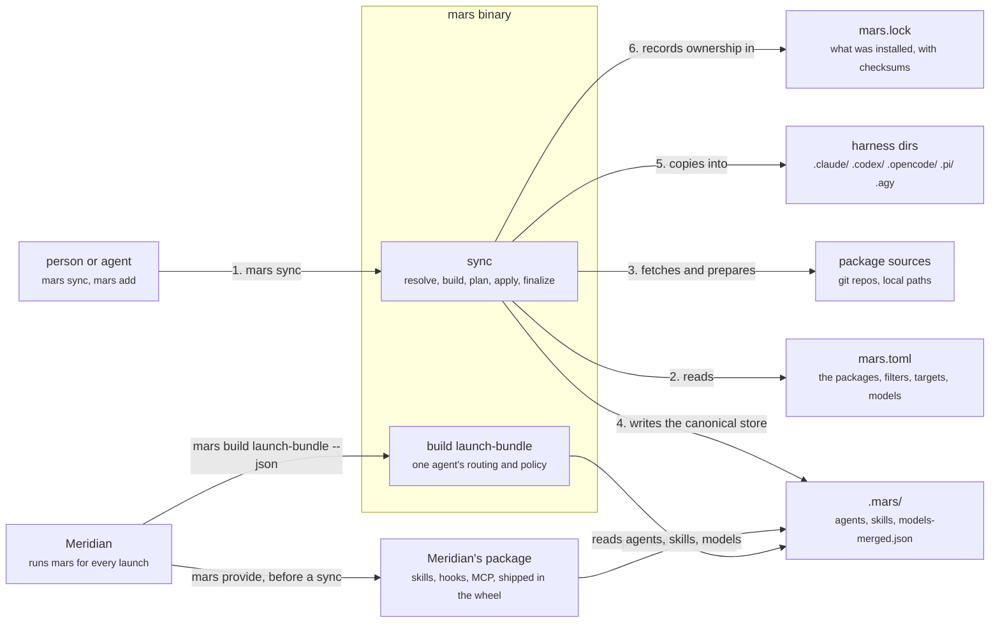

# Mars

- View: where it runs

Mars is the package manager for agent profiles and skills, a separate Rust binary (repository
`mars-agents`, released 0.41.0). It resolves the packages a project names into one store,
`.mars/`, and copies them into each harness's own directory, so a harness finds them as if
installed by hand. Packages stay harness-agnostic and work without Meridian. Meridian uses Mars
at every launch to learn what an agent is and how to route it. The numbered path is a
`mars sync`. Mars's own atlas covers its internals: `docs/atlas/` in mars-agents, unmerged as
PR #438. Its state machines sit beside its code (`src/sync/.context/state-machines.md` and the
index `.context/state-machines/index.md`).

## person

Whoever changes the project's packages, usually through `meridian mars sync`, `add` or
`upgrade`. A launch doesn't sync. It reads what the last sync left.

- Kind: person

## manifest

`mars.toml` (and an optional `mars.local.toml`): the dependencies, by git `url` or local `path`,
with filters, renames, the managed targets, model aliases and settings. Layers merge as user <
project < local < command line. A project with no `mars.toml` uses the user level.

- Kind: files
- Drift: Meridian 0.28.3 gives a project with no `mars.toml` the root `~/.meridian/mars`, set up with `mars init --root`. Mars 0.41.0 has its own user level at `~/.mars` (`MARS_HOME`), and Meridian 0.29.0 moves to it.

## sources

Where packages come from: git repositories, fetched and cached, and local directories. Each
package's manifest says what it holds: agents, skills, hooks, MCP servers, bootstrap docs.

- Kind: external

## provided

The Mars package Meridian ships inside its own install, `src/meridian/mars/`: Meridian's skills
for every harness, and the hooks and MCP server for agy, the one harness Meridian doesn't
launch. `meridian mars sync` (and `upgrade`, `add`, `remove`, `repair`, `validate`, `doctor`,
`build`) first registers it with `mars provide meridian@<version>=<dir> --root <root>`, then
passes the command on. When that is refused, Meridian falls back to the skills in its wheel. Its `agents/` directory is read in place
through `--provided-root` and never copied.

- Kind: files
- Paths: `src/meridian/mars`, `src/meridian/lib/bundled_skills.py`, `src/meridian/cli/mars_passthrough.py`

## sync

One `mars sync` is one durable transaction under `.mars/sync.lock`. It loads the config and the
lock, resolves and prepares every package, builds the target tree, plans installs, updates and
conflicts against the lock and the disk, writes the canonical store, copies it to the targets,
and writes `mars.lock`. Every phase before the apply is read-only. A kill mid-write leaves
`.mars/pending-canonical.json`, which the next sync checks and finishes.

- Kind: service

In 0.41.0 a skill a package names but doesn't have fails resolution (`skill not found`).
mars-agents PR #483, unreleased, turns that into a `missing-skill` warning at install and keeps
`mars check` strict.

Code (mars-agents): `src/sync/`, `src/resolve/`, `src/lock/`, `src/target/`.

## bundlecmd

`mars build launch-bundle --json`: for one agent, the routed model and harness, the effort,
approval, sandbox and network policy, typed tool rules, the loaded and missing skills, and where
each came from. Meridian requires Mars 0.41.0 and bundle schema 4.

- Kind: service
- Paths: `src/meridian/lib/launch/bundle_adapter.py`

Code (mars-agents): `src/build/bundle.rs`.

## store

`.mars/` in the project: the compiled agents and skills, `models-merged.json`, staging and the
write journal. Meridian reads `.mars/agents`, `.mars/skills` and `.mars/models-merged.json`
directly when the binary is missing, and `.mars/native-agents.json` for the agents copied into
a harness's own format.

- Kind: store
- Paths: `src/meridian/lib/catalog`

## lock

`mars.lock`, committed: each dependency's resolved version or commit, each installed item with
its source checksum and its outputs, the target config entries, and the model-alias winners.
Written sorted and atomically, so it reads the same on every machine.

- Kind: files

## targets

Each harness's own directory in the project. Mars owns only the files it installed. A file
someone changed by hand is a conflict the next sync reports, and the lock records which files are
Mars's.

- Kind: files

## meridian

Meridian's side, which runs `mars`: the catalog (`mars agents show`, `mars agents list`,
`mars models`, `mars models resolve`) and the launch (`mars build launch-bundle`), with
`--root`, `--fallback-root` and `--provided-root`. It finds the binary in its own install
environment, then on `PATH`. `meridian mars ...` passes any command straight through.

- Kind: service
- Paths: `src/meridian/lib/catalog`, `src/meridian/lib/ops/mars.py`, `src/meridian/cli/mars_passthrough.py`
- Drift: Meridian 0.29.0 replaces `lib/catalog/mars_roots.py` and `agent_copy.py` with one module, `lib/catalog/mars_cli.py`, and lists agents once per launch.
