# Agent to person

- View: a request's path

How an agent's answer reaches a person in Slack. The numbered path works today: the session runs
`meridian-comms send`, and the daemon posts as the bot. The dotted path is the route Meridian
ships for `meridian message @alice`. It hands the text to whatever program `[message] people`
names, and meridian-comms doesn't provide that program yet.

```mermaid
flowchart LR
  session["agent session<br/><small>a primary on the bot host</small>"]:::client
  send["meridian-comms send<br/><small>client: one JSON request</small>"]:::module
  sock["client socket<br/><small>owner-only Unix socket</small>"]:::files
  daemon["meridian-comms daemon<br/><small>checks the caller may post</small>"]:::service
  slack["Slack<br/><small>the bot's post in the thread</small>"]:::external
  person["person<br/><small>reads and replies in the thread</small>"]:::person
  msg["meridian message @alice<br/><small>Meridian's people route</small>"]:::module
  people["[message] people<br/><small>user config: the program to run</small>"]:::files
  deliver["meridian-comms deliver<br/><small>not in meridian-comms yet</small>"]:::external
  session -->|"1. send <message ref> --message"| send
  send -->|"2. identifies the caller from MERIDIAN_*"| sock
  sock -->|"3. request"| daemon
  daemon -->|"4. posts as the bot"| slack
  slack -->|"5. sees the answer"| person
  session -.->|"meridian message @alice"| msg
  msg -.->|"reads the program from"| people
  people -.->|"runs, address as argument, text on stdin"| deliver
```

## session

A Meridian primary on the bot host, identified by its `MERIDIAN_*` variables. A spawned child may
read threads but not post.

- Kind: client

## send

`meridian-comms send <message ref> --message <text>` posts in that message's thread, or opens one
with `--channel`. A post wakes nobody unless `--to` names someone. `--to <ref>` is a person's
choice and wakes that session even when it's cold.

- Kind: module

Code (meridian-comms): `src/client.rs`, `src/core/api.rs`.

## sock

The daemon's client socket: `/run/user/<uid>/meridian-comms.sock`, or under the state directory
when `/run/user/<uid>` doesn't exist.

- Kind: files

Code (meridian-comms): `src/paths.rs`.

## daemon

The daemon checks that the caller may post (`may_post`), posts through Slack's Web API, and
records the post in the thread's file.

- Kind: service
- Opens: [meridian-comms](comms.md)

## slack

The thread the person wrote in, or a new one.

- Kind: external

## person

Reads the answer and may reply in the same thread, which goes back through the wake rule.

- Kind: person

## msg

`meridian message @alice "..."`. An address that starts with `@` is a person or a thread, passed
as typed to the people program, with the text on stdin so it never reaches a command line.
With no program set, the command fails and names the missing setting.

- Kind: module
- Paths: `src/meridian/cli/message.py`, `src/meridian/lib/message`

## people

`[message] people` in `~/.meridian/config.toml`: the first words of the command, for example
`["meridian-comms", "deliver"]`. It's read from the user's own file only. `meridian message` runs
outside the harness sandbox, so a project file could otherwise make it run any program.

- Kind: files
- Paths: `src/meridian/lib/message/people.py`, `src/meridian/lib/config`

## deliver

meridian-comms has no `deliver` command at `47bcfd3`. Its commands are `read`, `send`, `list`,
`route`, `routes`, `setup` and the daemon. Until it ships one, `meridian message @alice` fails on
a machine that names it.

- Kind: external
- Drift: Meridian's people route and its docs name `meridian-comms deliver`, which meridian-comms doesn't provide yet.
