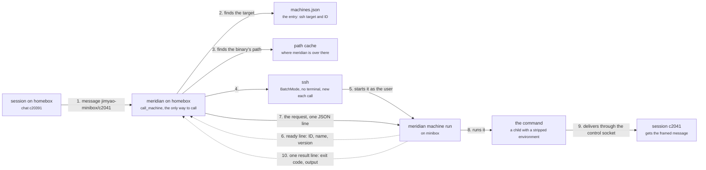

# A call to another machine

- View: a request's path

One command sent to a saved machine, for example `meridian message jimyao-minibox/c2041 "..."`
from a session on `homebox`. No link stays open between machines: each call is one `ssh`
connection. The command line it runs is always the same three words, and the command, its text
and who is calling travel as one JSON line on stdin, after the other side says it is ready.

## caller

The sending session. Who it is (machine ID, chat ID, project) goes in the request, so the
receiver can say who wrote and how to answer.

- Kind: client

## cli

`call.call_machine` returns one of three answers. `NotSent` means no ready line came, so nothing
was sent and a repeat is safe (`unreachable`, `auth`, `host_key`). `Unanswered` means the
request went out and no whole result came back: a command that changes state reports
`maybe_delivered` and says whether to repeat it. `Answered` carries the exit code, stdout and
stderr. It never sends twice by itself.

- Kind: module
- Paths: `src/meridian/lib/machines/call.py`, `src/meridian/lib/machines/ssh.py`, `src/meridian/lib/machines/results.py`

Time limits are kept together in `call.py`: 15 s for the ready line, 30 s for a read, 70 s for a
message.

## saved

The machine's entry in `~/.meridian/machines.json`. The ready line's ID must match the saved one.
The same ID under a new name rewrites the entry, and a different ID stops the call.

- Kind: files
- Paths: `src/meridian/lib/state/saved_machines.py`

## cache

`~/.meridian/cache/machines/<machine id>.json`: the path of `meridian` there and its version. A
non-interactive SSH login gets a short `PATH`, so the binary is found once and remembered. When
the cached path runs no Meridian (`ssh` exits, not 255, before a ready line), it is found again
once. Only a path of plain characters (`SAFE_PATH_RE`) goes on the command line.

- Kind: files
- Paths: `src/meridian/lib/machines/discover.py`

## ssh

The OpenSSH client. `BatchMode=yes`, so it never asks for a password, and `-T`, so a long request
line passes whole. An exit of 255 before the ready line is reported by `ssh.not_connected`, which
also tells a caller in its harness's sandbox that it is `sandboxed`. Meridian keeps no
connection open. A user who wants reuse sets `ControlMaster` in `~/.ssh/config`.

- Kind: external
- Keys: the user's SSH keys and `~/.ssh/config`, which Meridian never touches.

## run

`meridian machine run`, the receiving end. Nothing the user typed is on its command line. It
checks the request's version, the caller's block, and that the caller's machine ID isn't its
own (a copied home). It refuses a command that may not cross, checking a second time, and a
third machine. An older build with no `machine run` fails before the ready line, and the caller
reports both versions.

- Kind: module
- Paths: `src/meridian/cli/machine_run.py`

## child

The command runs as a child with only selected variables kept. Its `PATH` starts with a directory
holding only `meridian`. `machine run` ends the child's process group at the request's limit, or
when stdin closes, and still answers.

- Kind: module

## target

The receiving session. The message arrives framed with the sender (`jimyao-homebox/c20391`) and a
reply address, which works when homebox is in minibox's own saved list. The reply's options come
after the address, so the line still begins `meridian message`, which a harness sandbox lets
out.

- Kind: client
- Paths: `src/meridian/lib/message/reply.py`
