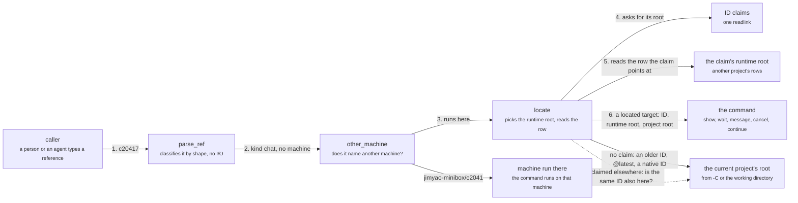

# Resolving a reference

- View: a request's path

What happens between a reference being typed and a command acting on it. The numbered path is a
claimed ID that belongs to another project, the case that needs no `-C`. The other arrows are a
reference that stays in the current project, and one that names another machine.

## caller

A person at a terminal or an agent in a session. For an ID with a claim, neither needs to know
which project the session is in.

- Kind: person

## parse

`parse_ref` in `lib/core/refs.py`. Shapes: `p<digits>`, `c<digits>`, a selector (`@latest` and the
other names in `SELECTORS`), `<machine>/<spawn or chat ID>`, `inbox` and `<machine>/inbox`, and
anything else as a native session ID. An `@` address for a person is not a reference: only
`meridian message` takes one (`lib/message/address.py`).

- Kind: module
- Paths: `src/meridian/lib/core/refs.py`, `src/meridian/lib/message/address.py`

## forward

`machine_forward.other_machine`, the one place a reference turns into another machine. It refuses
an unknown machine, two machines in one command, `-C` applied here beside `<machine>/<id>`, and
a third machine named by a call that another machine started. `forward_if_remote` then sends a
command that may cross.

- Kind: module
- Paths: `src/meridian/cli/machine_forward.py`

## locate

`locate()` in `lib/ops/locate.py`, the one place the runtime root is chosen. For a spawn or chat
ID it asks the claim first. When the claim points at another project, it reads the row there
and takes that project's directory from the row. `locate_run` and `resolve_spawn_target` return
a `RunTarget` with the ID, runtime root and project root.

- Kind: module
- Paths: `src/meridian/lib/ops/locate.py`

## claims

`claim_root(id)` builds the link's path from the ID and reads it, with no scan, whatever the
number of projects. A claim directory hidden by a sandbox reads as no claim.

- Kind: store
- Paths: `src/meridian/lib/state/machine_ids.py`

## theirs

The runtime root the claim names. The row is read there under that root's locks, and a missing
row is "not found".

- Kind: store

## own

The runtime root of the project the command runs in. It serves IDs with no claim (issued before
0.28, or by an older build still running), selectors and native IDs. When a claim points
elsewhere and the same ID is also here, the command refuses (`RefAmbiguous`) and asks for `-C`
rather than guess.

- Kind: store

## command

What is done with the target. Reads and messages act in the target's root. `--continue`
launches in the target's own project, `--from` reads it and launches here. A command acts as its
caller only inside the caller's own runtime root. Toward another project it sets no parent and
collects no result, as `-C` does.

- Kind: module
- Paths: `src/meridian/lib/ops/spawn/context_ref.py`, `src/meridian/lib/ops/session_target.py`, `src/meridian/lib/ops/reference.py`

## remote

A reference with a machine name runs on that machine, which drops its own name from the reference
([A call to another machine](remote-call.md)). There is no current project there, so the ID
resolves by its claim, and an older ID needs `--machine <name> -C <path there>`.

- Kind: service
