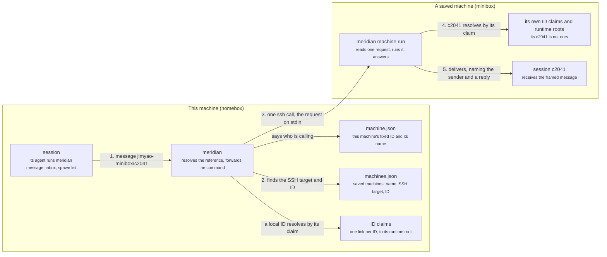

# Saved machines

- View: where it runs

How a session on one machine names and reaches a session on another. Each machine issues its
own spawn and chat IDs, keeps its own state and has its own inbox. A machine knows another only
once the user saves it with `meridian machine add`. A reference to a session there carries that
machine's name (`jimyao-minibox/c2041`), and the command runs there through one SSH call. The
design's reasons are in KB `machines.md`.

## session

A session whose agent names a session on another machine.

- Kind: client

## cli

`meridian` on the calling machine. `machine_forward.other_machine` decides which machine a
command names, and is the one place that refuses two machines or a third one. Only reading,
messaging and inbox commands may cross.

- Kind: service
- Paths: `src/meridian/cli/machine_forward.py`, `src/meridian/cli/machine_cmd.py`, `src/meridian/cli/machine_add.py`, `src/meridian/cli/machine_back.py`, `src/meridian/lib/machines`
- Opens: [Resolving a reference](resolve.md)

## identity

`~/.meridian/machine.json`: this machine's random ID, its name (by default the login name, a
hyphen and the short hostname), and its earlier names. Only `meridian machine rename` changes
the name. The ID is what says "same machine"; the name is for display and references.

- Kind: files
- Paths: `src/meridian/lib/state/machine_identity.py`

It is outside `config.toml`, which people sync between machines, so a synced config never
makes two machines one.

## saved

`~/.meridian/machines.json`: one entry per machine this one can reach, with `name`, `ssh` (a host
or alias that OpenSSH resolves), `id`, and the names it was saved under before (`was`). A call
compares the ID the other side states with the saved one. A rename rewrites the entry, and a
different ID stops the call.

- Kind: files
- Paths: `src/meridian/lib/state/saved_machines.py`
- Keys: none. Logins, keys and host keys stay with OpenSSH.

Every write takes a lock, reads the file again and replaces it whole. A file that can't be
parsed is an error and is never overwritten.

## claims

The machine-wide ID list. Its link both issues an ID and says which project holds it, so a
command in any project finds the session.

- Kind: store
- Paths: `src/meridian/lib/state/machine_ids.py`
- Opens: [Issuing an ID](ids.md)

## run

`meridian machine run` on the other machine, started by `ssh`. It prints a ready line (its ID,
name and version), reads one request line, checks it (version, caller, a machine ID that isn't
its own), runs the command as a child and answers with one result line.

- Kind: service
- Paths: `src/meridian/cli/machine_run.py`
- Opens: [A call to another machine](remote-call.md)

## rclaims

The other machine's own `~/.meridian/machine/ids/` and runtime roots. IDs are unique per
machine only, which is why a reference across machines carries the machine's name.

- Kind: store

## target

The receiving session. Its message is framed with the sender (`jimyao-homebox/c20391`) and how to
reply. The reply works when the sender's machine is in the receiver's own saved list, looked up by
its ID. `machine add` offers to save the way back.

- Kind: client
