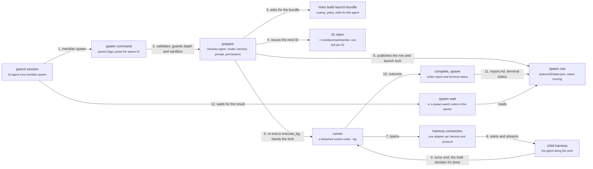

# A spawn, start to end

- View: a request's path

What happens when an agent runs `meridian spawn -a coder -p "..." --bg`, until its parent reads
the report. A primary launch (`meridian` with no command) takes the same path from step 2, with
a terminal instead of a parent and `lib/launch/process/` running the harness in the
foreground.

## parent

The session whose agent asked for the child: a primary, or another spawn. The child's row
records it as `parent_id`, and the chat that owes the result as `owner_chat_id`.

- Kind: client

## cmd

`meridian spawn` in `cli/spawn.py`, which calls `spawn_create_sync` in
`lib/ops/spawn/api.py`. It returns once the child is started (`--bg`) or finished
(foreground), and prints the ID.

- Kind: module
- Paths: `src/meridian/cli/spawn.py`, `src/meridian/lib/ops/spawn/api.py`

## prepare

Builds the whole launch before anything is persisted: the agent profile, model and harness, the
composed prompt with its skills and references, permissions and the sandbox, the working
directory. The depth guard runs first and stops a spawn that would go too deep, with no row.
The resolved sandbox must pass the caller's guardrail before any runtime file is written.

- Kind: module
- Paths: `src/meridian/lib/ops/spawn/prepare.py`, `src/meridian/lib/launch/composition_spawn.py`, `src/meridian/lib/launch/plan.py`, `src/meridian/lib/safety`

Meridian ignores Mars's precomposed prompt surfaces and composes its own prompt. It treats
the bundle's `tools.rules` as the permission contract.

## bundle

`mars build launch-bundle --json`, run by `lib/launch/bundle_adapter.py`. The answer names the
agent and its source, the routed model and harness, the effort, approval, sandbox and network
policy, the tool rules and the loaded and missing skills. Meridian requires Mars 0.41.0 or newer,
with bundle schema 4, and refuses a bundle without its routing fields.

- Kind: external
- Paths: `src/meridian/lib/launch/bundle_adapter.py`
- See: [Mars](mars.md)

## ids

The machine-wide ID list. Creating the link `~/.meridian/machine/ids/p/21/p21048` issues
`p21048`: the link is unique by construction, and its target names the runtime root, so a later
command in any project can find the spawn.

- Kind: store
- Paths: `src/meridian/lib/state/machine_ids.py`
- See: [Issuing an ID](ids.md)

## row

`~/.meridian/projects/<project>/spawns/<id>/state.json`, the authoritative record of the spawn,
with one subdirectory per launch holding its prompt, output, stderr and report. `launch.lock`
beside it is held by the runner for its whole life. A free lock means the runner is gone.

- Kind: store
- Paths: `src/meridian/lib/state/spawn_store.py`, `src/meridian/lib/state/spawn`
- Machines: [a spawn's status](../../src/meridian/lib/state/spawn/.context/state-machines.md)

## worker

Under `--bg`, `execute_spawn_background` re-executes Python as `meridian.lib.ops.spawn.execute_bg`
in a detached process that inherits the launch lock's file descriptor. A foreground spawn runs
the same runner in the calling process. Foreground and background meet at
`launch_prepared_spawn` (`execute_runner.py`), which owns what a failure before the harness ran writes.

- Kind: service
- Paths: `src/meridian/lib/ops/spawn/execute.py`, `src/meridian/lib/ops/spawn/execute_bg.py`, `src/meridian/lib/ops/spawn/execute_runner.py`, `src/meridian/lib/launch/streaming_runner.py`, `src/meridian/lib/streaming`
- Machines: [the completion hold](../../src/meridian/lib/streaming/.context/state-machines.md)

It serves the spawn's control socket, so `meridian message p21048` reaches the child, and
drains the harness's events into `output.jsonl`.

## conn

The adapter that speaks the harness's protocol: Claude over a WebSocket (`claude_ws.py`), Codex
app-server (`codex_ws.py`), OpenCode over HTTP (`opencode_http.py`, `opencode_v2_http.py`), Pi over
RPC (`pi_rpc.py`). Each reports startup phases as telemetry (`launching_subprocess` up to
`harness.ready` or `harness.failed`). They are not stored state.

- Kind: module
- Paths: `src/meridian/lib/harness/connections`

## harness

The child's harness process, with the composed prompt and Meridian's environment
(`MERIDIAN_SPAWN_ID`, `MERIDIAN_CHAT_ID`, the work directory). Its native session stays in the
harness's own store and can be resumed without Meridian.

- Kind: client

## finish

`SpawnApplicationService.complete_spawn` in `lib/core/spawn_service.py`: under the spawn's
mutation lock it writes `report.md` and the terminal status, then dispatches the
`spawn.finished` lifecycle event to hooks (`lib/core/lifecycle.py`). If the runner died, the next reader sees the lock free and `finalize_dead_launch`
writes `failed` (`crashed`) or `cancelled` instead.

- Kind: module
- Paths: `src/meridian/lib/core/spawn_service.py`, `src/meridian/lib/core/lifecycle.py`, `src/meridian/lib/state/spawn_status.py`

## wait

`meridian spawn wait` (`spawn_wait` in `lib/ops/spawn/api.py`) blocks until each named or owed child is terminal, and prints its report.
In Claude Code the `meridian-spawn-watch` plugin tells the parent when a child it owes finishes,
so the parent need not block.

- Kind: module
- Paths: `src/meridian/lib/ops/spawn/owed.py`, `src/meridian/claude_runtime/meridian-spawn-watch`
