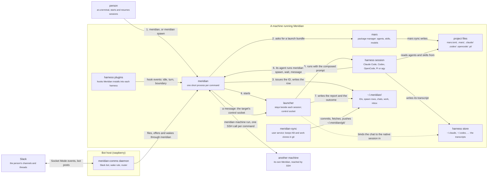

# System

- View: where it runs

What runs on a machine that uses Meridian, and where its state rests. The numbered path is the
main thing Meridian does: a person starts a session, and its agent starts another. The bot host
is the machine that runs meridian-comms for Slack. Each machine has its own Meridian, and they
reach each other only over SSH.

## person

Someone running agents. They use several harnesses, start and kill sessions, and come back days
later. They can stop using Meridian at any time and keep every session, because each one is a
native session in the harness's own store.

- Kind: person

## cli

The `meridian` command. Each run starts, does one thing and exits: it parses arguments,
resolves a reference to a spawn or chat, and acts in that project's runtime root. A launch runs
in a launcher process (`launcher`).

- Kind: service
- Paths: `src/meridian/cli`, `src/meridian/lib/ops`
- See: [Code](code.md)
- Docs: [commands](../commands.md)

An agent calls it from inside a harness. The command line starts with `meridian`, which is what
a harness's sandbox lets out. An agent can't ask what a flag means, so the command's `-h` and
its `--json` output are its contract with every script and tool that calls it.

## mars

The Mars binary, a separate Rust program. Meridian finds it in its own install environment
first, then on `PATH`. It runs `mars build launch-bundle` for every launch, and `mars agents`,
`mars models` and `mars provide` for catalogs and its bundled skills. `meridian mars ...` passes
the command straight through.

- Kind: service
- Paths: `src/meridian/lib/catalog`, `src/meridian/lib/launch/bundle_adapter.py`
- Opens: [Mars](mars.md)
- Drift: Meridian 0.29.0 (`release/v0.29.0`) moves Mars's user level from `~/.meridian/mars` to `~/.mars` and puts every Mars call in one module, `lib/catalog/mars_cli.py`.

## project

The project's checkout. `mars.toml` and `mars.lock` say which packages it uses. `.mars/` holds
the resolved agents, skills and model catalog. Mars copies them into each harness's own
directory (`.claude/`, `.codex/`, `.opencode/`, `.pi/`), where the harness finds them as if
installed by hand. Meridian never creates a `.meridian/` directory in a project.

- Kind: files

## launcher

The Meridian process that stays beside each session for its whole life. It holds the spawn's
launch lock, starts the harness, serves the session's control socket, drains the harness's
events, and writes the report and the outcome when the harness ends. `spawn --bg` runs the same
code in a detached worker.

- Kind: service
- Paths: `src/meridian/lib/launch`, `src/meridian/lib/streaming`
- Opens: [A spawn, start to end](spawn.md)
- Machines: [a spawn's status](../../src/meridian/lib/state/spawn/.context/state-machines.md), [an idle stretch](../../src/meridian/lib/idle/.context/state-machines.md)

The control socket is `/tmp/meridian-<uid>/control-<sha256 of runtime root and spawn ID>.sock`.
A sender computes the name and never looks it up. That is why a reference has to resolve to a
runtime root before a message can be sent.

## harness

The harness process: Claude Code, Codex, OpenCode or Pi, started by the launcher. Meridian
never starts agy itself. agy's own plugin calls `meridian harness-hook agy`, and Meridian adopts
the session.

- Kind: client
- Paths: `src/meridian/lib/harness`
- Machines: [a chat's generation](../../src/meridian/lib/state/.context/state-machines.md)

What a harness does with its own config, skills, plugins, auth and transcripts stays the
harness's. Every harness specific in Meridian lives in `lib/harness/`, one adapter per harness.

## runtime

What Meridian puts inside a harness so the harness reports to it: Claude Code plugins
(`meridian-idle`, `meridian-spawn-watch`, `meridian-session-boundary`,
`meridian-first-turn`), Pi extensions, the tool-policy evaluator shared by Pi and Codex, and the
agy hook and MCP server shipped as a Mars package.

- Kind: module
- Paths: `src/meridian/claude_runtime`, `src/meridian/pi_runtime`, `src/meridian/tool_policy_runtime`, `src/meridian/mars`
- See: [Code](code.md)

## state

Everything Meridian records, as files under `~/.meridian/` (`$MERIDIAN_HOME`): the machine's
identity and ID claims, one runtime root per project with its spawn rows and chat journal, work
items, the machine inbox and the saved machines. SQLite indexes some of it and can always be
rebuilt.

- Kind: store
- Paths: `src/meridian/lib/state`
- See: [Data](data.md)
- Machines: [a work item](../../src/meridian/lib/state/.context/state-machines.md), [an inbox message](../../src/meridian/lib/inbox/.context/state-machines.md)

Meridian gets killed mid-write all the time. Every write is atomic, every read survives a
half-written file, and recovery runs when the next command starts.

## native

Each harness's own session store: `~/.claude` (or `CLAUDE_CONFIG_DIR`), `~/.codex` (or
`CODEX_HOME`), OpenCode's storage, `~/.pi/agent`, and agy's `~/.gemini/antigravity-cli/`.
Meridian reads transcripts from here and binds each chat to one native session. It writes
nothing here that the harness wouldn't.

- Kind: store
- Keys: each harness's own sign-in. Meridian holds no model credentials.

## syncd

`meridian-sync`, a small Rust daemon shipped as its own wheel at Meridian's version. It runs as a
user service (systemd or launchd) and keeps the git clones of the KB and work directories under
`~/.meridian/git/` committed, fetched and pushed. Python's side writes one record per project
checkout under `~/.meridian/autosync/` and starts the service when it finds none running.

- Kind: service
- Paths: `crates/meridian-sync`, `src/meridian/lib/autosync`

## comms

meridian-comms, a separate Rust daemon, runs as a user service on the bot host. It holds one
Slack Socket Mode connection, keeps each thread's state, and wakes the sessions a person names.
A message that names nobody goes into Meridian's machine inbox, where its router may offer it to
one running session. It reaches Meridian only through the `meridian` command and its JSON.

- Kind: service
- Opens: [meridian-comms](comms.md)
- Keys: Slack app and bot tokens, and `OPENCODE_API_KEY` for its router's model, in `~/.config/meridian-comms/slack.env` on the bot host.

Code: the `meridian-comms` repository (`src/daemon.rs`, `src/core/`, `src/source/meridian/`).

## slack

The person's Slack workspace. The person mentions the bot in a channel and gets answers in the
same thread.

- Kind: external

## peer

Another machine the user has saved with `meridian machine add`. Each machine keeps its own
IDs, state and inbox. A reference such as `jimyao-minibox/c2041` runs the command on that
machine through one non-interactive `ssh` call to `meridian machine run`. Meridian opens no
port of its own.

- Kind: external
- Opens: [Saved machines](saved-machines.md)
- Keys: the user's own SSH login (`~/.ssh`), which Meridian never touches.
