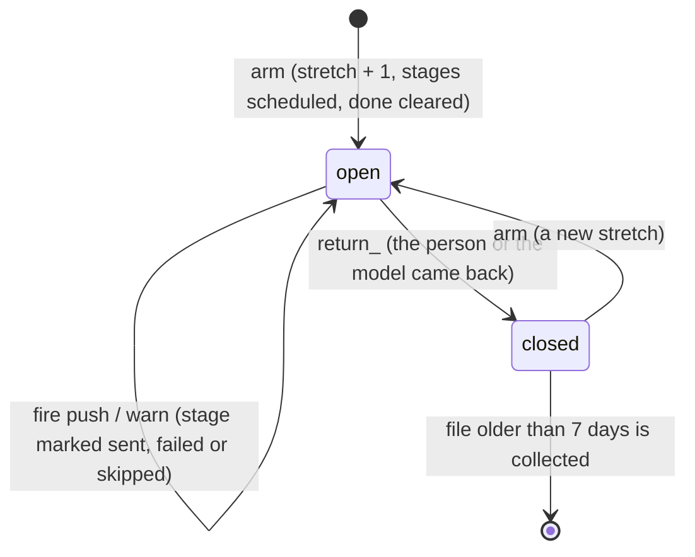

# State machine: an idle stretch

One harness session's time between the model going quiet and the person coming back.
Meridian sends one *push* (a notification that the session is waiting) and one *warn* (the
prompt cache is about to go cold) per stretch. State: `~/.meridian/idle/<harness>-<session>.json`
(`state/idle_store.py:IdleState`). There is no status enum. The machine is spread over
`stretch_open`, the `stretch` and `anchor` counters, `schedule.push_at`/`warn_at`, and
`done["push"]`/`done["warn"]`. The policy and its reasons are in [CONTEXT.md](CONTEXT.md) and
KB `spawns/idle-notifications.md`.

- **A stage fires once.** `fire` claims the stage in `done` before sending, so a crash after
  the claim loses that notice instead of sending it twice. A warning that acts also marks the
  push `skipped:warned`.
- **Guards** (`guards.py`) skip a stage that is stale, late, disabled or for a session that
  isn't a primary, and record why as `skipped:<reason>`.
- **Keepwarm** pings and the state reminder ride the single warning. Their own record is in
  memory (`keepwarm.py`) or in the Claude mod's state and does not survive a restart, on
  purpose: a new `IdleState` field would break older builds' reads.
- Change this diagram with `service.py` (`arm`, `return_`, `fire`).

**What a rewrite could drop.** Five fields stand in for one state, and the keepwarm half lives
outside it, in memory or in a harness mod. A process that stays up for the session could hold
the stretch as one value with an explicit state.
