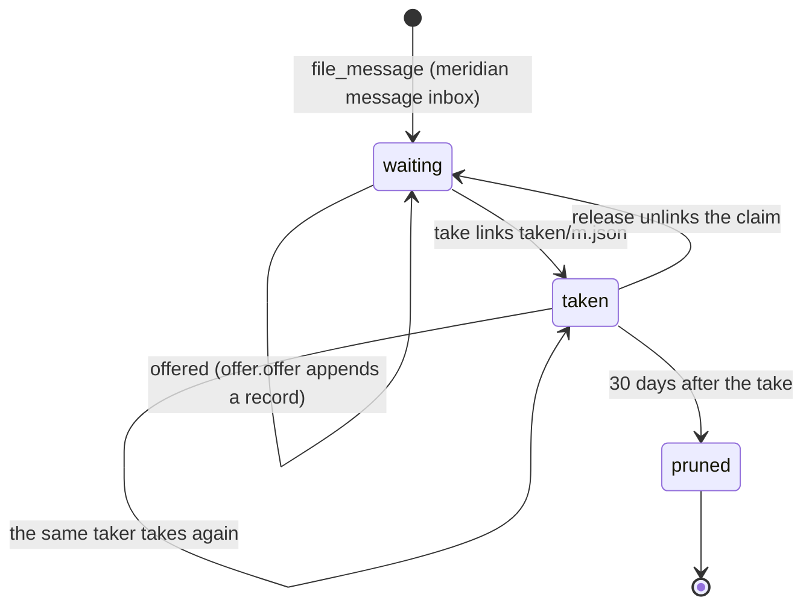

# State machine: a message in the machine inbox

One message under `~/.meridian/machine/inbox/`. It has no status field: which files exist is
the state. `messages/m<n>.json` is the message, `taken/m<n>.json` the claim, and
`offered/m<n>.json` the offers. The layout and the order of every write are in
[CONTEXT.md](CONTEXT.md).

- **Offered is not a state of its own.** An offer sends a fixed notice to one primary and
  records that it did. It grants nothing, so an offered message still waits for anyone allowed
  to take it. `meridian inbox list` shows the offers.
- **Reading changes nothing.** `meridian inbox read` prints a message without claiming it.
- **Nothing expires a waiting message.** Prune deletes only messages taken more than 30 days
  ago, and deletes the claim last, so a kill mid-prune never makes a taken message look
  waiting again.
- **Who may move it.** A terminal (a person, the comms daemon) may do anything. A primary may
  take, release and offer. Any other session may only list and read (`caller.py`).
- **Across machines** each machine has its own inbox. A command for another machine's inbox
  runs there through `meridian machine run`. A take repeated after a lost answer succeeds,
  because the taker is (machine ID, chat ID).
- Change this diagram with `store.py`, `offer.py` or `prune.py`.
