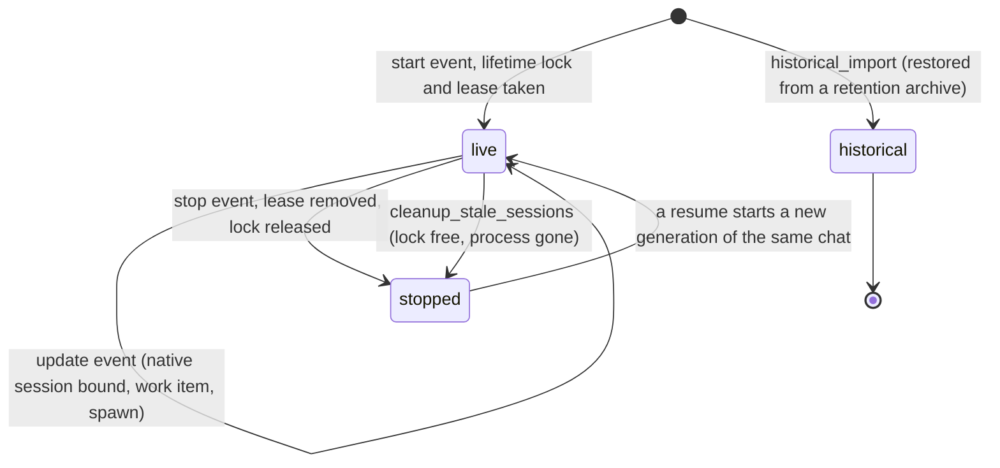
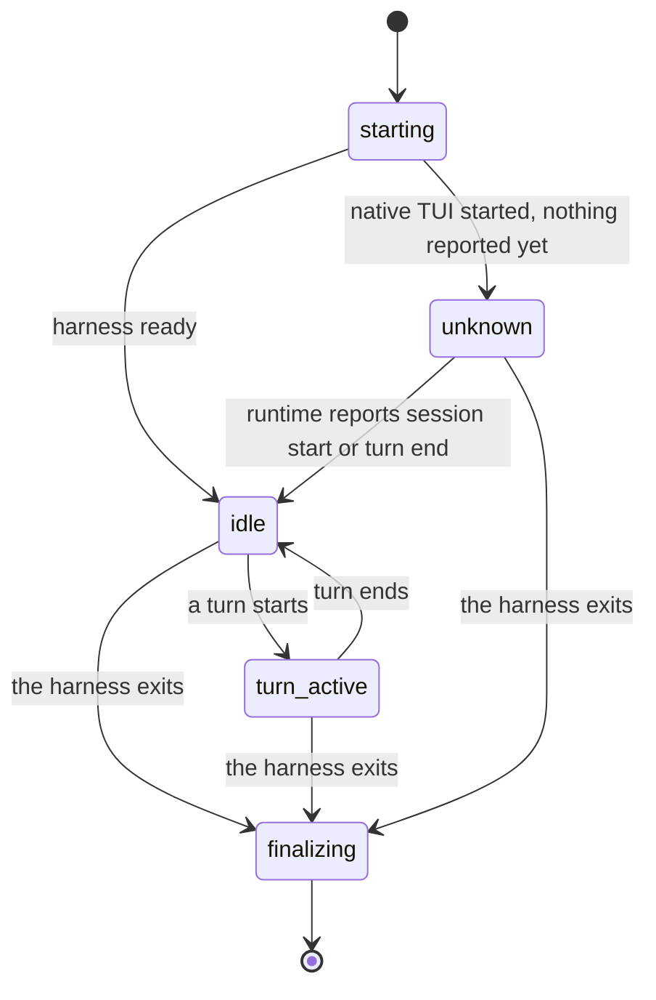
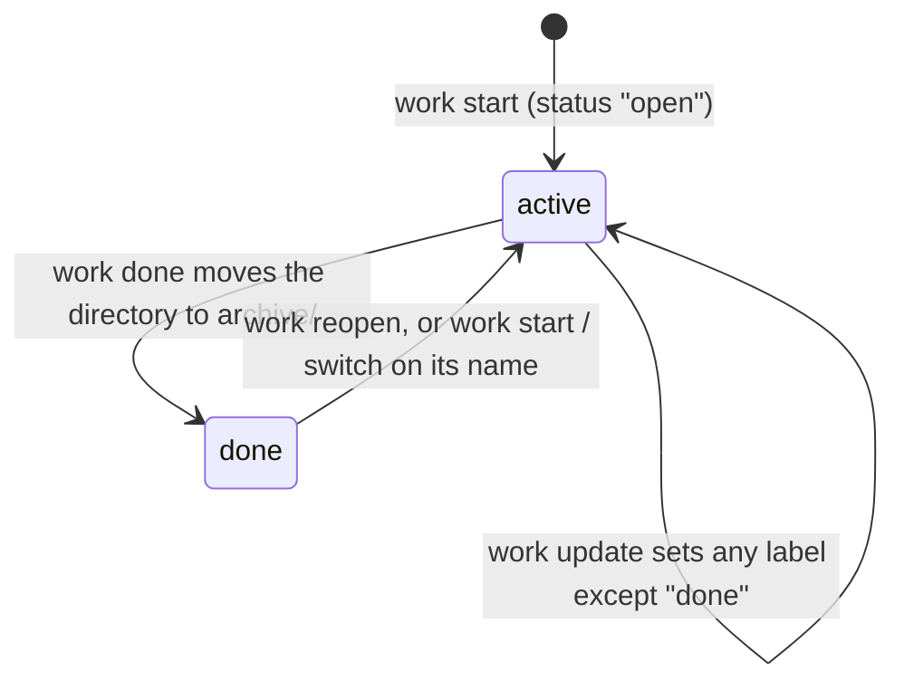

# State machines: chats, primaries and work items

## A chat's generation

A chat (`c<id>`) is the conversation Meridian tracks for one harness session. A spawn runs
in one chat. A primary can change chats when the harness starts a new conversation inside the
same process, as Claude's `/clear` does. A chat has no file of its own: its events are lines
in the runtime root's `sessions.jsonl`, folded by `session_fold.py`. One *generation* is one
`(chat_id, session_instance_id)` pair.

- **Writers.** `session_store.start_session` appends the start event, takes the chat's
  lifetime lock and writes its lease. `stop_session` appends the stop event. `update` events
  bind the native session (`session_binding.py`), attach a work item, or name the spawn.
- **The binding never changes.** A chat keeps one `(harness, native_store,
  harness_session_id)`. An empty field may be filled once. A different value is refused,
  except through a `relocate` event, so a chat never silently points at another conversation.
- **`/clear` is not a transition of the chat.** The harness opens a new conversation, so
  Meridian stops the old chat and starts a new one. The launch keeps the entry chat's lifetime
  lock (`launch/.context/CONTEXT.md`, "Environment and lifetime").
- **After a crash** the last event is a start with no stop. Whether the chat is live comes
  from its lifetime lock and lease, not from the journal. `cleanup_stale_sessions` appends the
  missing stop.
- Change this diagram with `session_fold.py` or `session_store.py`.

## A primary's activity

`<launch>/primary_meta.json`, field `activity` (`primary_meta.py`): what a running primary is
doing. `meridian spawn list` shows it, and meridian-comms reads it to choose who may be
offered a message.

`unknown` is no stored value: `spawn list` shows it for a running primary whose file has no
`activity`, or no file. A Claude row has no runner write and gets its first file from the mod.

This is a projection, not authority. Two writers:

- Codex and OpenCode (managed): `primary_attach.py` follows the server stream and rewrites the
  whole file (`write_primary_metadata`).
- Native primaries: the runner writes `starting` and `finalizing` through
  `write_native_primary_metadata`, and the runtimes report each turn edge through
  `record_turn_activity` (the Claude mod and Pi extension via `meridian idle activity` or
  `idle arm`; agy's hold from its sensor). Both read-modify-write under the published-artifact
  lock, so the runner's TUI-started write keeps a turn already reported, and `finalizing` wins
  over a report that arrives late. A runtime too old to report leaves the row `unknown`.

**What a rewrite could drop.** The managed attach could report through the same seam instead
of owning a whole-file copy in memory.

## A work item

A work item is a directory, `work/<slug>/` (active) or `archive/work/<slug>/` (done), with
`__status.json` beside its files (`work_repository.py`, `work_state.py`). Where the directory
is decides the state. The `status` field is a label.

- **Archive** moves the directory first, then writes `status: done`. A crash between the two
  leaves an archived directory, which reads as done.
- **Reopen** writes the status first, then moves the directory back. A crash leaves an
  archived directory with an active label. The repeat finishes the move, and
  `repair_work_item` normalizes the label from the location.
- `"done"` is refused as an active label, so there is one way to finish an item.
