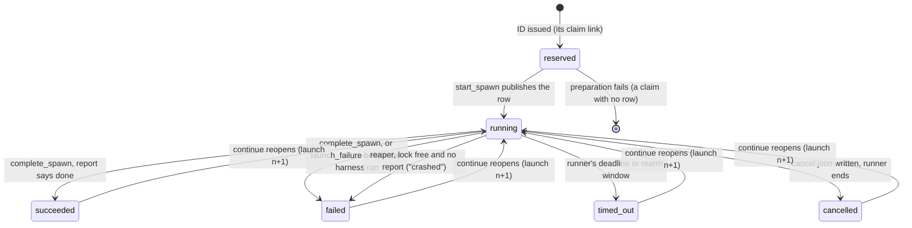
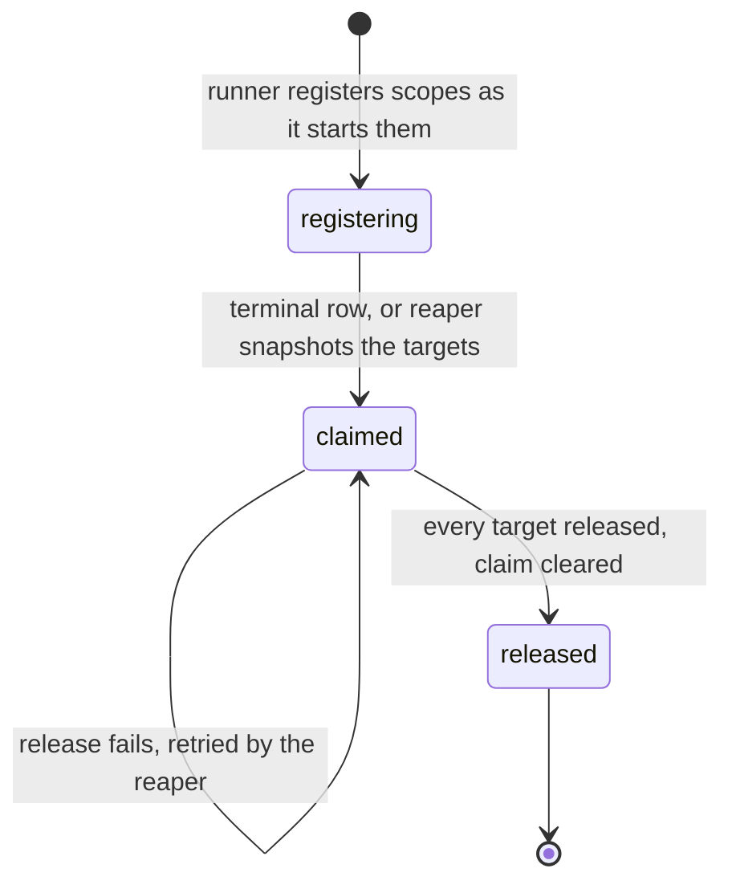

# State machines: a spawn

## A spawn's status

The `status` field of `spawns/<id>/state.json` in the spawn's runtime root
(`model.py`, vocabulary in `core/domain.py:SpawnStatus`). A spawn is one agent run with its own
ID. `meridian spawn` starts one, and so does a primary launch. A continue reopens the same row
for another launch.

- **Stored states.** This build stores only `running` and the four terminal states. `reserved`
  is not a status. It is the ID's claim under `~/.meridian/machine/ids/`
  (`spawn_store.reserve_launch`), made before any row exists. The runner-lifetime lock
  (`launch.lock`, `state/launch_lock.py`) is published with the row and held until the runner
  exits. `queued` and `finalizing` are in
  `SpawnStatus`, and no code here writes either one. `finalizing` reaches a caller only as the
  answer to a `cancel` whose runner still holds the lock at the deadline
  (`spawn/service.py`, `cancel`). A row that says `unknown` is read for compatibility.
- **Who writes the end.** The process holding the launch lock writes the terminal status
  through `SpawnApplicationService.complete_spawn`, under the per-spawn mutation lock. When
  the runner died, the launch lock is free. Readers then *derive* a terminal status without
  storing it (`state/spawn_status.py:derive`): `succeeded` if the report shows a durable
  completion, `cancelled` if a cancel intent exists, otherwise `failed` with error `crashed`.
  Only `finalize_dead_launch`, after `claim_dead_launch` takes the lock, writes that derived
  status. A wrong edit that lets a reader persist it would race a live runner.
- **Cancel** writes `cancel.json` first (the first request wins), then sends SIGTERM, waits,
  and sends SIGKILL to the verified process tree. The intent outlives every process, so a
  crash mid-cancel still ends as `cancelled`.
- **Continue** keeps the ID. `reopen_spawn` archives the terminal row as launch `n`, writes
  launch `n+1`'s prompt and sets `running`, all under the launch lock. A setup error leaves the
  old row untouched.
- Change this diagram in the same commit as `transitions.py`, `spawn_store.start_spawn`,
  `reopen_spawn` or `spawn_status.derive`.

**What a rewrite could drop.** The status is partly rebuilt after the fact. A dead runner is
detected through a free `flock` and named by a reaper. "Running" combines the stored status,
the lock and the PID's birth time, and each reader that needs liveness overlays the derived
value (`read_derived`, `overlay_derived`). A
supervisor that owns each runner would see it exit and write the outcome itself. `queued` and
`finalizing` could go from the vocabulary.

## Process-scope cleanup claim

`spawns/<id>/reaper_cleanup_claim.json` (`state/reaper_cleanup_claim.py`): the process scopes
(PID groups, cgroups, managed backends) a finished spawn still has to release.

Once the row is terminal, or once a claim exists, `process_scope_projection` refuses to
register a new scope. That stops a late child from escaping cleanup. The claim survives the
terminal row on purpose, because cleanup can outlast the spawn's outcome.

**What a rewrite could drop.** The claim exists because the spawn's processes have no owner
once the runner dies. A per-spawn runner that a supervisor watches would release its own
scopes.
