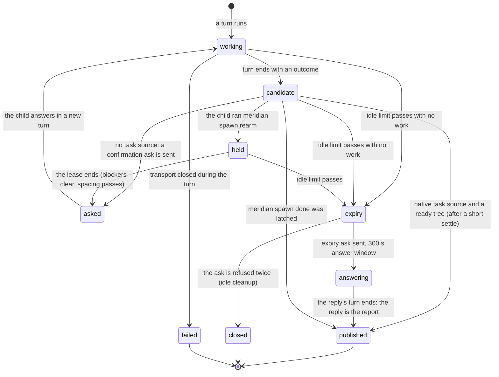

# State machine: the completion hold

When is a child spawn finished? A one-shot harness run (`codex exec`, `opencode run`) is
finished when its process exits. A *resident* child keeps its harness open between turns,
because it can start background work, wait on its own children or be messaged, so a turn end
doesn't prove it is done. The hold decides. Its state is one value, `HoldState` in
`hold_state.py`, and its rules are one precedence table, `decide(state, facts)`, with no I/O.
`_HoldProfile` in `resident_drain.py` reads the files and the clock and applies what `decide`
returns. Why each row is where it is: [completion-and-entry-points.md](completion-and-entry-points.md).

The diagram shows the states a reader needs. `HoldState` spreads them over `ask`, `answer`,
`lease`, `rearmed`, `stays`, `closing`, `reply_replaces` and `reply_closes`.

- **Only work renews the idle limit.** A rearm and work inside a turn renew it. A turn start,
  a Meridian nudge, a heartbeat or a user message doesn't. Otherwise a chatty idle child could
  keep itself alive forever.
- **A running turn outdates the candidate.** Later evidence must never publish an old reply.
- **A parent is woken** for unread child results on a ready tree, naming each owed launch
  once, and only after the ask or wake is delivered.
- `hold.json` (a checkpoint between turns) and `rearms.jsonl` (rearms granted) are side files
  in the launch directory, because spawn rows refuse unknown fields.
- Pi doesn't use this hold. It waits for its descendants to go quiet
  (`pi_completion_profile.py`, `pi_drain.py`). `--timeout` is a separate absolute ceiling over
  both.
- Change this diagram with `decide` in `hold_state.py`.

**What a rewrite could drop.** This is the largest machine in Meridian: ten fields, and a
decision table that fills most of a 636-line module. It exists because Meridian infers "finished" from a harness's turn ends,
renews, asks and timers. If the child said it was done (`meridian spawn done`) or a process
owned its descendants, most rows would have nothing to decide.
