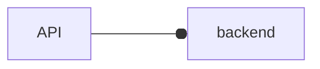

# Mermaid Style Warnings

`meridian mermaid check` reports these categories.

| Category | Diagrams | Fires on |
|---|---|---|
| `ox-edge` | flowchart | `---o` or `---x` followed directly by a lowercase letter (`A ---oauth`): Mermaid reads a circle or cross edge ending to a node named `auth`. To reach a node named `oauth`, add a space: `A --- oauth`. `---oNode` is not flagged; it reads as a deliberate circle edge to `Node`. |
| `bare-end` | flowchart | An unquoted lowercase `end` inside another statement (`A --> end`), where Mermaid reads the subgraph terminator. Write `End`, `END`, or quote it (`B["end"]`). A line that is only `end` closes a subgraph and is not flagged. |
| `fill-no-color` | any | An inline `style` line that sets `fill:` without `color:`, which can leave text unreadable in light or dark themes. `classDef` lines are not checked. |

## Suppressing a Deliberate Warning

Put a Mermaid comment inside the diagram, with the reason on the line above it so the
next reader sees why:

- `%% mermaid-check-ignore-next-line CATEGORY` covers the line directly below it.
- `%% mermaid-check-ignore CATEGORY` anywhere in the diagram covers the whole diagram.
- Leaving out `CATEGORY` suppresses every category for that line or diagram.

Prefer the next-line form and a named category; suppress the whole diagram only when the
same deliberate construct repeats through it. Suppressed warnings drop out of the text
report; `--format json` lists them under `suppressed` with the comment that suppressed
each one.
